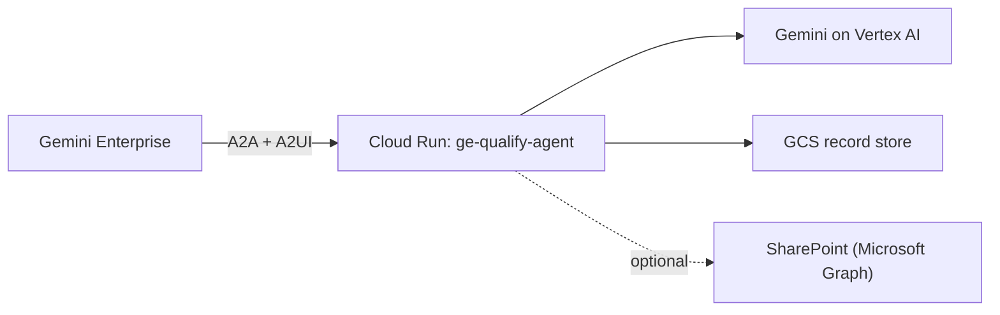

# GE Use Case Qualification Agent

Qualify, review, and rank enterprise AI use cases in Gemini Enterprise with
Business Value Briefs, Technical Dossiers, and a prioritized portfolio.

> **Status: early access.** Usable today and under active iteration.
> Demo page: [go/demos/demo/2213](https://demospace.corp.goog/demo/2213).

## What it does

Enterprise AI Centers of Excellence receive dozens of generative AI requests
but evaluate them with disconnected spreadsheets and repeated workshops. This
agent embeds the [GE App Use Case Discovery Framework](docs/framework.md) in
Gemini Enterprise. Stakeholders collaborate through natural chat and
interactive A2UI forms, and every value the agent extracts is shown for them to
confirm or correct.

| Phase | Who | Output |
| :--- | :--- | :--- |
| 1. Business Value Intake | Business owner | **Business Value Brief**: annual hours saved and the recommended Gemini Enterprise agent tier |
| 2. Technical Architecture Review | Solution architect | **Technical Architecture Dossier**: 22-subcriteria readiness score, feasibility profile, access checklist |
| 3. CoE Portfolio Prioritization | CoE lead | **Portfolio report**: use cases ranked by value and feasibility into Quick Wins, Strategic Bets, Departmental Niche, and Deprioritized |

In chat, type `help` for all commands, `technical review` to pick up a
finished brief, or `portfolio review` to see the ranking.

### Agent tiers

| Level | Capability | Tier |
| :--- | :--- | :--- |
| 1-2 | Default assistant, assistant with custom skill | Tier 1: No-Code |
| 3-4 | Workflow Builder chat agent, workflow agent | Tier 2: Low-Code |
| 5-6 | Workflow agent with custom MCP server, custom ADK / A2A agent | Tier 3: Pro-Code |

## Architecture



- **Records** are saved to a GCS bucket (`QUALIFY_GCS_BUCKET`) with optimistic
  concurrency; the portfolio and the pending-review list read from it.
- **SharePoint (optional)**: users sign in with Microsoft through a signed,
  per-conversation link, and briefs, dossiers and portfolio reports are saved
  to a shared folder under their own identity.
- **Access**: only the Gemini Enterprise (and, with SharePoint, IAP) service
  agents may invoke Cloud Run, and the app verifies the A2A caller
  (`A2A_AUTH_MODE`). Secrets live in Secret Manager.

## Deploy

| Option | SharePoint | How |
| :--- | :--- | :--- |
| **One-click demo** (go/demos, Argolis) | Off | Click **Click-To-Deploy** on [go/demos/demo/2213](https://demospace.corp.goog/demo/2213). Terraform in [`click-to-deploy/`](click-to-deploy/README.md) creates Cloud Run, a GCS bucket with synthetic seed data, and a Gemini Enterprise app with the agent registered. |
| **With SharePoint** | On | Needs a Microsoft Entra app (client ID, tenant, secret) and a SharePoint site in `.env`, then run the scripts below. |

```bash
scripts/setup_lb.sh       # once: Load Balancer, managed cert, IAP (for Microsoft sign-in)
scripts/deploy.sh         # build and deploy to Cloud Run, set invokers
scripts/register_ge.sh    # once: register the agent in Gemini Enterprise
scripts/sync_ge_agent.sh  # after agent card changes: refresh the GE registration
```

Useful overrides for `deploy.sh`: `A2A_AUTH_MODE=enforce|log`, `SIGNIN_CARD=0|1`.

## Run locally

```bash
uv sync
uv run pytest -q                                # unit tests
HOST=127.0.0.1 SHAREPOINT_MOCK=1 uv run start   # http://127.0.0.1:8080
```

Uses your `gcloud` Application Default Credentials and `.env`
(`GOOGLE_CLOUD_PROJECT`, `MODEL`). `SHAREPOINT_MOCK=1` writes documents to
`.data/sharepoint_mock/` instead of calling Microsoft Graph.

## Standalone skills

Chat-only versions of Phases 1 and 2 that run as plain Gemini Enterprise
skills, without deploying the agent:

| Skill | Deliverable | Download |
| :--- | :--- | :--- |
| `ge-intake-business` | Business Value Brief | [`.zip`](https://github.com/cloud-gtm/ge-qualification-agent/releases/latest/download/ge_intake_business.zip) · [source](skills/ge_intake_business/SKILL.md) |
| `ge-review-tech` | Technical Architecture Dossier & Access Checklist | [`.zip`](https://github.com/cloud-gtm/ge-qualification-agent/releases/latest/download/ge_tech_review.zip) · [source](skills/ge_tech_review/SKILL.md) |

Rebuild the zips with `python3 skills/package_skills.py`.

## Repository layout

| Path | Contents |
| :--- | :--- |
| `qualify/agent/` | A2A server, turn engine, Phase 1 → 2 handover, caller verification |
| `qualify/a2ui/` | A2UI form compiler, actions, views and charts |
| `qualify/packs/` | Interview definitions (`business.yaml`, `tech.yaml`) |
| `qualify/scoring/`, `qualify/export/` | Tier, readiness and portfolio scoring; brief, dossier and report rendering |
| `qualify/connectors/`, `qualify/sinks/` | SharePoint storage, signed sign-in links, session and record stores |
| `click-to-deploy/` | go/demos Terraform |
| `scripts/` | Deploy, registration and Load Balancer scripts |
| `skills/` | Standalone Gemini Enterprise skills |
| `docs/` | [Framework](docs/framework.md), [demo guide](docs/demo-guide-ge-qualify-agent.md), [design doc](docs/ddd-ge-qualify-agent.md) |
