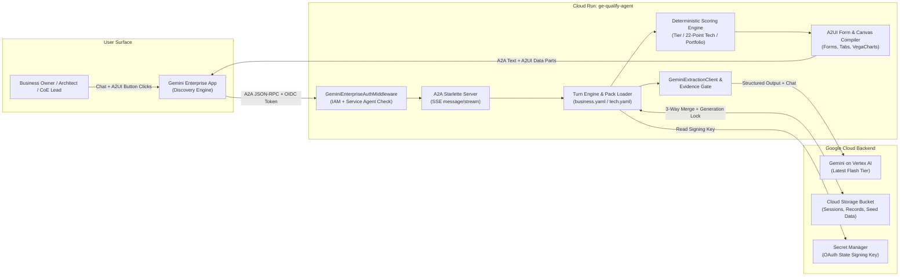

<!-- linter off -->
<!-- common_typos_disable -->

# **Demo Design Document: GE Use Case Qualification Agent**

| **Self-link:** docs/ddd-ge-qualify-agent.md | **Last Updated:** 2026-10-09 |
|---|---|
| **Authors:** giuliosalierno | **Status:** APPROVED |
| **Team/Org:** FDE | **Demo Type:** Live |
| **Target Tier:** Tier 2 (Customer-Ready, default) | **Governing Standard:** [Cloud Demo Standard](https://docs.google.com/document/d/1XeeyP_8xPTw4NpzCOd8VxYrUf1Ul60RM8b8jqcbFbCs) |
| **Demo Page (External):** docs/GE Use Case Qualification Agent_metadata.yaml | **Demo Narrative/Guide:** [docs/demo-guide-ge-qualify-agent.md](./demo-guide-ge-qualify-agent.md) |
| **Related PRD/Design Doc:** [GE App Use Case Discovery Framework](../docs/framework.md) | **Git Repository:** https://github.com/cloud-gtm/ge-qualification-agent |
| **Replaces / Complements:** N/A - first demo in this space | **Created:** 2026-10-09 |

---

## **1. Executive Summary**

This demo shows how an enterprise AI Center of Excellence (CoE) uses a native Gemini Enterprise agent with interactive A2UI forms to qualify, architecturally review, and rank AI use cases across business units in minutes rather than weeks of disconnected spreadsheets and workshops. It turns unstructured business requests into quantified Business Value Briefs (annual hours saved and Capability Levels 1-6), 22-subcriteria Technical Architecture Dossiers, and a 4-quadrant Portfolio Prioritization matrix inside Gemini Enterprise.

---

## **2. Problem Statement & Background**

### **2.1. The Problem**
Enterprise AI Centers of Excellence (CoEs) receive dozens of generative AI requests from business units, but lack a shared, structured process to evaluate business value before committing engineering capacity.
*   **Current Process:** Business stakeholders submit vague ideas via forms or spreadsheets; solution architects run repetitive discovery calls to gather system, security, and ACL requirements; CoE leads manually score and compare opportunities across incompatible templates.
*   **Primary Users:** Business Unit Owners (Phase 1 intake), Solution Architects and Security Leads (Phase 2 technical review), and AI CoE Leads / Forward-Deployed Engineers (Activity 3 portfolio prioritization).
*   **Key Issues:** Unquantified ROI claims, over-engineering simple no-code workloads into costly custom builds, late discovery of security or network blockers, and repeated questioning of stakeholders across phases.

### **2.2. Why Now? (Context & Urgency)**
*   **Market Need:** Enterprises adopting Gemini Enterprise need a repeatable methodology (the GE App Use Case Discovery Framework) to build a governed, high-ROI backlog and separate immediate no-code Quick Wins from pro-code Strategic Bets.
*   **Technological Readiness:** Gemini Enterprise supports custom A2A agents with rich A2UI side-panel forms, allowing conversational extraction and structured form validation to happen simultaneously in a single workspace.
*   **Competitive Landscape:** Competing copilot platforms offer generic chat assistants or static intake forms, forcing teams back into manual spreadsheets for capability tiering, technical readiness scoring, and portfolio ranking.

### **2.3. User Groups & Key Concerns**
*   **Business Unit Owners (Front Office):** Want to articulate their workflow pain in plain language without knowing cloud architecture, and receive immediate sizing and no-code guidance.
*   **Solution Architects & IT Security (Back Office):** Need complete technical specifications - data sources, network transit, IAM/ACL preservation, data residency, and latency SLAs - scored against a deterministic readiness rubric.
*   **AI CoE Leads & Executives:** Need an objective, apples-to-apples portfolio view ranking every intake by Business Value (1-5) and Technical Feasibility (1-5) into actionable delivery quadrants.

---

## **3. Objective & Scope**

### **3.1. Overall Objective**
Demonstrate how Gemini Enterprise and the GE Use Case Qualification Agent compress multi-week AI use case discovery into a 10-minute, three-phase governed workflow that produces a quantified Business Value Brief, a 22-point Technical Architecture Dossier, and a live Portfolio Prioritization dashboard.

### **3.2. Ideal Outcome**
*   Equip Google Cloud field teams (CEs, FDEs, Architects) with a one-click deployable qualification agent for customer discovery workshops.
*   Show customers how Gemini Enterprise combines conversational AI with deterministic scoring and interactive A2UI forms.
*   Provide a reference architecture for building production A2A + A2UI agents on Cloud Run backed by Gemini on the Gemini Enterprise Agent Platform (formerly Vertex AI).

### **3.3. In-Scope (Core Demo Features)**
*   **Phase 1 - Business Value Intake (4 stages):** Conversational + A2UI form capture of Problem & Users, Effort & Value (annual hours saved over 50 work weeks), Data & Systems, and Ownership, producing a **Business Value Brief** and deterministic **Capability Level (1-6)** assignment.
*   **Phase 2 - Technical Architecture Review (5 stages):** Handover of locked Phase 1 baselines to a Solution Architect to evaluate Systems & Data, Network & Transit, Security & IAM, Data Grounding & Model Routing, and Operational Readiness, producing a **22-subcriteria Technical Architecture Dossier**, **Key 2 Readiness status**, and **Access Checklist**.
*   **Phase 3 - CoE Portfolio Prioritization:** Aggregation of all qualified records (including 3 pre-seeded Cymbal opportunities) into a 4-quadrant matrix (**Quick Wins**, **Strategic Bets**, **Departmental Niche**, **Deprioritized**) with Vega-Lite visualizations and drill-down actions.
*   **Two Standalone GE Skills:** `ge-intake-business` and `ge-review-tech` packaged for zero-infrastructure chat-only qualification.

### **3.4. Out-of-Scope**
*   **Live SharePoint / Microsoft Graph OAuth write-back in Click-to-Deploy:** The codebase supports delegated SharePoint and Google Drive export behind an external Load Balancer and IAP, but the one-click `go/demos` deployment sets `STORAGE_PROVIDER=none` and `SIGNIN_CARD=0` so it deploys cleanly in any Argolis project with zero external Entra ID dependencies.
*   **Automated provisioning of downstream use cases:** The agent qualifies, scores, and scopes use cases; it does not auto-generate the target production agents it qualifies.

### **3.5. Requirements & Priorities**

| Priority | Business Requirement | User Story |
|---|---|---|
| P0 | Interactive 4-stage Business Intake with live A2UI form pre-filling | As a Business Owner, I want to describe my use case in chat and see the structured form fields populate automatically so I can verify and submit a Business Value Brief in under 3 minutes. |
| P0 | Deterministic ROI sizing and GE Capability Level (1-6) mapping | As a CoE Lead, I need annual hours saved (`U × T × S × 50 / 60`) and capability tiers calculated deterministically with anti-overcommitment rules so estimates are auditable. |
| P0 | Phase 1 → Phase 2 handover and 5-stage Technical Review | As a Solution Architect, I want to pick a pending Business Value Brief in a separate chat, keep its business baseline locked, and score 22 technical subcriteria to produce a Technical Architecture Dossier. |
| P0 | CoE Portfolio Prioritization matrix with pre-seeded Cymbal records | As a CoE Lead, I want to type `portfolio review` on first launch and immediately inspect a 4-quadrant portfolio combining pre-seeded Cymbal use cases and newly qualified opportunities. |
| P1 | Optimistic concurrency and multi-actor record integrity in Cloud Storage | As a platform owner, I need concurrent business and technical sessions to merge cleanly via GCS generation preconditions so neither persona overwrites the other's work. |
| P2 | Optional SharePoint / Google Drive document export | As an enterprise architect in a full production setup, I want finished briefs and dossiers exported to our corporate document repository under delegated user credentials. |

---

## **4. Demo Strategy & Narrative**

### **4.1. Demo Thesis**
Today, I will show you how Gemini Enterprise and the GE Use Case Qualification Agent replace weeks of fragmented AI intake spreadsheets with a governed, three-phase agentic workflow - turning a raw finance automation idea into a quantified 10,000-hour/year Business Value Brief, a 22-point Technical Architecture Dossier, and a prioritized CoE portfolio in under 10 minutes.

### **4.2. Overall Narrative Approach**
*   **Focus on Value, Not Features:** Frame every stage around preventing the two biggest AI CoE failures: building low-value science projects and over-engineering simple no-code assistants into expensive custom builds.
*   **Feature -> Benefit -> Value:**
    *   *Dual Chat + A2UI Form Extraction* -> Stakeholders speak naturally while the agent fills structured fields with evidence checks -> *Zero form fatigue and 100% structured data capture.*
    *   *Anti-Overcommitment Capability Engine (Levels 1-6)* -> Automatically routes read-only Drive Q&A to Level 2 (No-Code Skill) and SAP/Outlook workflows to Level 5 (Pro-Code MCP) -> *Saves months of unnecessary engineering.*
    *   *Cross-Session GCS Record Handover* -> Architects pick up exact business baselines without re-interviewing the business -> *Cuts technical scoping lead time by 70%.*

### **4.3. Demo Narrative & Storyboard**
*   **Setup:** Introduce **Maria Rossi** (AP Operations Manager at Cymbal) who wants an AI agent to help her 30 accounts payable clerks handle supplier invoice emails, **Paolo Verdi** (Solution Architect) who must vet SAP and M365 security, and the **AI CoE Lead** who must decide what to fund first.
*   **Product in Action:**
    1.  **Welcome & Orientation:** Presenter opens Gemini Enterprise, selects `@GE Use Case Qualification Agent`, and types `hello what can you do?`. The agent renders the welcome card with three workflow entry points.
    2.  **Act 1 - Business Value Intake (Maria):** Presenter clicks **Business Value Intake** and describes the *Supplier query assistant* in natural language. Across 4 stages (Problem & Users → Effort & Value → Data & Systems → Ownership), the agent extracts fields into the A2UI card, calculates **10,000 hours/year saved** (`30 clerks × 40 queries/wk × 10 min saved × 50 weeks`), assigns **Level 5 (Tier 3: Pro-Code - Workflow agent with custom MCP server)**, and generates the **Business Value Brief**.
    3.  **Act 2 - Technical Architecture Review (Paolo):** Presenter types `technical review`, selects the newly created *Supplier query assistant* record alongside seeded Cymbal opportunities, and walks through the 5 technical stages (SAP S/4HANA real-time freshness, Milan on-prem PSC transit, Entra ID SSO + EU data residency, strict citations + ACL preservation, landing zone in progress). The agent produces the **Technical Architecture Dossier** (68% readiness across 22 subcriteria).
    4.  **Act 3 - CoE Portfolio Prioritization (CoE Lead):** Presenter types `portfolio review`. The agent scores all 4 opportunities (3 Cymbal seeds + the new AP use case totaling **95,500 hrs/yr** across **660 users**) and plots them on the 4-quadrant chart, highlighting *Claims intake triage* (`UC-2026-DEMO01`) as the top **Quick Win** and *Supplier query assistant* as a **Strategic Bet**.
*   **Resolution:** In under 10 minutes, three personas moved from an unstructured idea to a board-ready Business Brief, an architect-verified Technical Dossier, and a ranked CoE portfolio - all inside Gemini Enterprise.

### **4.4. Differentiators**
*   **Native A2A + Interactive A2UI Side-Panel Forms inside Gemini Enterprise** - *vs. Microsoft Copilot Studio / generic chat-only intake bots; shown in Act 1 & Act 2 when natural-language chat turns dynamically patch live A2UI form cards, tables, and Vega charts alongside the conversation.*
*   **Evidence-Gated Extraction & Deterministic Scoring Engine** - *vs. prompt-only LLM wrappers that hallucinate ROI benchmarks or let users self-inflate scores; shown in Act 1 Stage 2 & Act 2 Stage 5 where every extracted field is verified against the user's verbatim text and scored by deterministic Python rules (`qualify/scoring/`).*
*   **Multi-Persona Handover with Three-Way Merge Concurrency** - *vs. isolated single-session chat threads; shown in Act 2 & Act 3 when the Solution Architect and CoE Lead seamlessly load, review, and rank the Business Owner's record from Cloud Storage.*

### **4.5. Call to Action (CTA)**
Deploy the GE Use Case Qualification Agent into your Argolis project via **go/demos Click-to-Deploy** (or install the standalone `ge-intake-business` and `ge-review-tech` skills) to run a live AI Use Case Discovery & Portfolio Prioritization workshop with your customer's CoE.

### **4.6. Audience Variants**

| Audience | Duration | Highlight | Skip or Mention Only |
|---|---|---|---|
| **C-suite / AI CoE Executive** | 5-7 min | Act 1 Stage 1-2 (value sizing), Business Value Brief output, and Act 3 Portfolio Prioritization 4-quadrant matrix | Act 2 stages 2-4 (detailed network/IAM/grounding subcriteria) - jump straight to a pre-seeded record's dossier |
| **Solution Architect / IT Security** | 15 min | Full Act 1 → Act 2 handover, 22-subcriteria technical rubric, blocker detection (Key 2 gating), and Cloud Run IAM architecture | Deep dive into Python unit tests or Terraform state internals |
| **Developer / Demo Engineer** | 25-30 min | Full 3-act flow plus A2A SSE streaming, A2UI surface patching, YAML interview pack definitions (`business.yaml`, `tech.yaml`), and C2D Terraform | High-level CoE governance background |

---

## **5. Technical Implementation Details**

### **5.1. Architecture Overview**

The Click-to-Deploy architecture deploys a private, IAM-guarded A2A + A2UI agent on Cloud Run registered natively inside a Gemini Enterprise search engine, backed by Gemini on the Gemini Enterprise Agent Platform (formerly Vertex AI) and Cloud Storage.



*   **Supplementary Diagram (optional):** See [`click-to-deploy/README.md`](../click-to-deploy/README.md) and root [`README.md`](../README.md) for the optional SharePoint / Load Balancer + IAP production topology.

### **5.2. Core Components & Google Cloud Services**
*   **Gemini Enterprise (Discovery Engine - `discoveryengine.googleapis.com`):** Hosts the enterprise search & assistant web interface (`google_discovery_engine_search_engine`), renders A2UI surfaces (cards, inputs, tabs, Vega charts, markdown canvases), and invokes the agent over A2A using the Discovery Engine service agent (`service-<PROJECT_NUMBER>@gcp-sa-discoveryengine.iam.gserviceaccount.com`).
*   **Gemini on Gemini Enterprise Agent Platform (formerly Vertex AI - `aiplatform.googleapis.com`):** Powers dual-pass structured field extraction (`GeminiExtractionClient`) and consultative stage replies (`GeminiChatClient`) using the latest Gemini Flash tier (`MODEL` env var, default `gemini-3.8-flash`, served from `GOOGLE_CLOUD_LOCATION=global`).
*   **Cloud Run v2 (`run.googleapis.com`):** Hosts the stateless Python 3.12 Starlette/Uvicorn container (`ge-qualify-agent`), scaled `0..1` with `roles/run.invoker` granted exclusively to the Discovery Engine service agent (no `allUsers` access).
*   **Cloud Storage (`storage.googleapis.com`):** Two private buckets with uniform bucket-level access and `public_access_prevention = "enforced"`:
    *   Records bucket (`<project>-ge-qualify-agent`): Stores active conversation sessions (`sessions/*.json`), completed use case records (`records/*.json`), and portfolio snapshots (`portfolio/latest.md`, `portfolio/latest.json`), pre-populated with 3 synthetic Cymbal records.
    *   Build staging bucket (`<project>-ge-qualify-agent-build`): Holds Cloud Build source archives with a 7-day auto-delete lifecycle rule.
*   **Secret Manager (`secretmanager.googleapis.com`):** Stores the per-deployment random 64-character hex signing secret (`ge-qualify-agent-oauth-state`) mounted into Cloud Run as `OAUTH_STATE_SECRET`.
*   **Artifact Registry & Cloud Build (`artifactregistry.googleapis.com`, `cloudbuild.googleapis.com`):** Builds the container image from source using `--require-hashes --only-binary=:all:` and pushes it to a dedicated Docker repository (`ge-qualify-agent`) using a least-privilege custom build service account.

### **5.3. Design Patterns & Agents (if applicable)**
*   **Declarative Interview Packs (`qualify/packs/business.yaml`, `qualify/packs/tech.yaml`):** Define stages, fields, types, option hints, validation rules, and whether a stage is required or skippable.
*   **Evidence-Gated Extraction (`qualify/a2ui/patcher.py`):** The LLM proposes field values paired with verbatim quotes from the user's message; a deterministic check rejects any extraction whose quote does not appear in the user's actual words, preventing hallucinated form fills.
*   **Deterministic Scoring (`qualify/scoring/`):**
    *   `tier.py`: Evaluates data sources, write-back actions, orchestration complexity, and governance flags to assign Capability Levels 1-6 and Delivery Tiers 1-3 with anti-overcommitment rules.
    *   `technical.py`: Scores 22 subcriteria across 5 architectural categories (0-100%), distinguishes unconfirmed (`unknown`) vs. confirmed hard blockers on critical gates (2.4 Transit Blocker, 3.5 Cloud Policy), and computes `key2_ready`.
    *   `portfolio.py`: Computes Value (1-5) and Feasibility (1-5) scores and segments records into 4 quadrants.
*   **Reopenable A2A Task Store (`qualify/agent/task_store.py`):** Wraps `InMemoryTaskStore` so every turn returns `completed` (allowing Gemini Enterprise to render the turn cleanly) while permitting A2UI button clicks on older cards to reopen the task seamlessly.
*   **Per-Context Async Lock & Optimistic Concurrency (`qualify/agent/executor.py`, `qualify/sinks/record_store.py`):** Serializes turns per `context_id` via `WeakValueDictionary[str, asyncio.Lock]`, runs synchronous turn execution in `asyncio.to_thread`, and performs a 3-way merge against `Session.record_base` with GCS `if_generation_match` preconditions and 412 retry.

### **5.4. Data Details**
*   **Source:** 100% synthetic data under the fictional **Cymbal** brand (`Cymbal Insurance`, `Cymbal Retail`, `Cymbal Bank`). Zero customer or internal Google data.
*   **Format & Volume:** Three pre-generated JSON records (`click-to-deploy/demo/seed/records/UC-2026-DEMO01.json` through `DEMO03.json`) plus pre-rendered portfolio summaries (`portfolio/latest.json`, `portfolio/latest.md`), totaling ~15 KB:
    1.  `UC-2026-DEMO01` - **Claims intake triage** (Cymbal Insurance, 120 handlers, 28,000 hrs/yr, Level 4 Low-Code Workflow Agent, waiting for Phase 2 tech review).
    2.  `UC-2026-DEMO02` - **Store policy assistant** (Cymbal Retail, 450 store managers, 45,000 hrs/yr, Level 2 No-Code Custom Skill, both Phase 1 & Phase 2 complete, 100% tech readiness - **Quick Win**).
    3.  `UC-2026-DEMO03` - **KYC document pre-check** (Cymbal Bank, 60 analysts, 12,500 hrs/yr, Level 6 Pro-Code High-Code Agent, waiting for Phase 2 tech review).
*   **Generation/Refresh:** Regenerated deterministically via `uv run python click-to-deploy/demo/seed/generate_seed.py` and verified against schema drift by `tests/test_seed_data.py`.

### **5.5. Serving & Deployment Options**
*   **Target:** Cloud Run v2 (`ge-qualify-agent`) + Gemini Enterprise Engine (`ge-qualify-agent-app-<hex>`).
*   **Use Case:** Field-team one-click self-service deployment into Argolis via `go/demos` Click-to-Deploy (`click-to-deploy/demo/terraform/` and `click-to-deploy/org_policy/`).
*   **Environment Externalization:** All runtime parameters are injected via Cloud Run environment variables in `click-to-deploy/demo/terraform/run.tf`: `GOOGLE_CLOUD_PROJECT`, `GOOGLE_CLOUD_LOCATION` (default `global`), `GOOGLE_GENAI_USE_VERTEXAI=TRUE`, `MODEL` (default `gemini-3.8-flash`), `PROJECT_NUMBER`, `QUALIFY_GCS_BUCKET`, `AGENT_URL`, `A2A_AUDIENCES`, `A2A_AUTH_MODE=enforce`, `A2A_TRUST_CLOUD_RUN_IAM=1`, `STORAGE_PROVIDER=none`, `SIGNIN_CARD=0`, `WEB_OAUTH_CALLBACK=0`, and `OAUTH_STATE_SECRET` (from Secret Manager).
*   **Infrastructure as Code (IaC):** Full Terraform automation in `click-to-deploy/demo/terraform/` conforming to the `go/demos` CDP standard (`base_variables.tf` with the 8 mandatory CDP variables, `org_policy/project_config.json`, idempotent `ensure_ge_license.sh` and `register_agent.sh` scripts, and `random_id` suffixing on Discovery Engine IDs for clean destroy/redeploy cycles).
*   **Rollback Strategy:** Cloud Run revision pinning and `terraform destroy` / re-apply.

### **5.6. Interface Contract (Frontend ↔ Backend)**
The primary user interface in Click-to-Deploy is **Gemini Enterprise**, which communicates with the Cloud Run service over the **A2A JSON-RPC 2.0 protocol** with **A2UI v0.9 extension data parts**. The service also exposes a local/standalone web harness and MCP routes:

*   **Endpoint:** `GET /.well-known/agent-card.json`
    *   **Request:** No body; authenticated via Google-signed OIDC ID token (`Authorization: Bearer <id_token>`).
    *   **Response (200):** A2A `AgentCard` JSON declaring `streaming: true`, extension URI `https://a2ui.org/a2a-extension/a2ui/v0.9`, and skills `business_value_intake`, `technical_architecture_review`, and `portfolio_prioritization`.
    *   **Mode:** Blocking JSON.
    *   **Errors:** `401`/`403` JSON `{ "error": str }` if `A2A_AUTH_MODE=enforce` and caller is not the Discovery Engine service agent.
*   **Endpoint:** `POST /` (A2A JSON-RPC 2.0 endpoint)
    *   **Request:**
        ```json
        {
          "jsonrpc": "2.0",
          "id": "string",
          "method": "message/stream",
          "params": {
            "message": {
              "kind": "message",
              "role": "user",
              "messageId": "uuid",
              "contextId": "string",
              "taskId": "optional-uuid",
              "parts": [
                { "kind": "text", "text": "string" },
                { "kind": "data", "data": { "userAction": { "name": "commit_stage", "surfaceId": "string", "context": {} } } }
              ]
            }
          }
        }
        ```
    *   **Response (200):** `text/event-stream` (SSE) emitting JSON-RPC `Task` / `TaskStatusUpdateEvent` / `TaskArtifactUpdateEvent` frames containing Markdown text parts (`kind: "text"`) and A2UI v0.9 surface commands (`kind: "data"`, `mimeType: "application/json+a2ui"` with `createSurface`, `updateComponents`, `updateDataModel`).
    *   **Mode:** Server-Sent Events (SSE) via `message/stream` (also supports unary `message/send`).
    *   **Errors:** JSON-RPC error object `{ "jsonrpc": "2.0", "id": "string", "error": { "code": int, "message": str } }` or HTTP `401`/`403` on unauthorized caller.
*   **Endpoint:** `GET /` and `GET /api/me`
    *   **Request:** Browser GET (used for local development harness `uv run start`).
    *   **Response (200):** HTML standalone test harness (`GET /`) and caller identity JSON `{ "email": str | null, "authenticated": bool }` (`GET /api/me`).
    *   **Mode:** Blocking HTML / JSON.
    *   **Errors:** Non-2xx with `{ "error": str }`.

### **5.7. Prerequisites & Environment Setup**
*   **GCP Project:** Fresh Argolis project with billing enabled.
*   **APIs to Enable (automated via `org_policy/project_config.json` and `apis.tf`):** `aiplatform.googleapis.com`, `artifactregistry.googleapis.com`, `cloudbuild.googleapis.com`, `cloudresourcemanager.googleapis.com`, `discoveryengine.googleapis.com`, `iam.googleapis.com`, `logging.googleapis.com`, `orgpolicy.googleapis.com`, `run.googleapis.com`, `secretmanager.googleapis.com`, `serviceusage.googleapis.com`, `storage.googleapis.com`.
*   **Org Policy Override (automated via `org_policy/project_config.json`):** `iam.disableServiceAccountCreation` set to `enforced: false` during deployment (`restore_post_deployment: true`).
*   **IAM Roles & Service Accounts:**
    *   Runtime SA (`ge-qualify-agent-run@<project>.iam.gserviceaccount.com`): `roles/aiplatform.user` (project), `roles/storage.objectUser` (records bucket only), `roles/secretmanager.secretAccessor` (OAuth state secret only).
    *   Build SA (`ge-qualify-agent-build@<project>.iam.gserviceaccount.com`): `roles/logging.logWriter` (project), `roles/artifactregistry.writer` (repo only), `roles/storage.objectViewer` (build staging bucket only).
    *   Invoker binding: `service-<project_number>@gcp-sa-discoveryengine.iam.gserviceaccount.com` granted `roles/run.invoker` on `ge-qualify-agent`.
*   **Quotas:** Standard Gemini Flash QPM on Vertex AI (`global` endpoint) and 1 Gemini Enterprise trial license (automatically activated by `ensure_ge_license.sh`).
*   **Local Tooling (for manual CLI run or local dev):** `gcloud` CLI authenticated with ADC, Terraform >= 1.5, Python 3.12, `uv`, `curl`.

### **5.8. Cost Estimate**
*   **One-time Setup:** ~$0.05 (one Cloud Build container build + KBs in Artifact Registry and Cloud Storage).
*   **Per-Demo Run:** ~$0.02 per full 15-turn walkthrough (Gemini Flash calls on Vertex AI + negligible Cloud Run CPU-seconds).
*   **Monthly Infrastructure (always-on):** < $1.00/month when idle. Cloud Run scales to zero (`min_instance_count = 0`, `cpu_idle = true`), GCS stores < 1 MB, Secret Manager stores 1 secret version, and Gemini Enterprise uses the 30-day free trial license on fresh Argolis projects.
*   **Cost Optimization Notes:** Scale-to-zero is enabled by default; the build staging bucket automatically deletes source tarballs after 7 days.

---

## **6. Operational Readiness & Support**

### **6.1. Demo Quality & Reproducibility**
*   **Deployment Idempotency:** Tested across full `terraform apply` → `terraform plan` (exit code 0, zero drift) → `terraform destroy` → `terraform apply` cycles in Argolis project `ge-qualify-c2d-test`. Discovery Engine data stores and engines use a `random_id` suffix so destroying and re-creating in the same project never collides with GCP's soft-delete tombstones, and `register_agent.sh` updates existing agent registrations in place.
*   **Pre-flight Validation:** `ensure_ge_license.sh` and `register_agent.sh` validate access tokens, paginate existing agents, and retry transient IAM/Discovery Engine propagation delays (`403`, `429`, `5xx`, `FAILED_PRECONDITION`).
*   **Resilience & Latency (LLM/Agentic demos):** Fast path handles deterministic commands (`help`, `technical review`, `portfolio review`, stage navigation) without LLM latency (~1-3s); extraction + chat turns run on `gemini-3.8-flash` in ~4-9s over SSE (`message/stream`). If Gemini extraction fails or returns invalid JSON, the turn engine degrades gracefully and keeps the A2UI form editable so the presenter can type or select values directly on the card.
*   **Responsible AI & Safety Defaults (GenAI demos):** Evidence gating requires every extracted field to cite a verbatim substring of the user's message; ROI math and capability levels are computed by deterministic Python functions rather than free-form LLM generation.
*   **Freshness & Maintenance:** Model ID is externalized via `var.model` / `MODEL` env var; 871 automated pytest unit and integration tests validate schema, scoring, A2UI compilation, supply-chain hashes, and seed data integrity.

### **6.2. Availability & Maintainability**
*   **Bug Fixes/Support:** Maintained by the demo owner (`giuliosalierno`) via GitHub issues and PRs on `cloud-gtm/ge-qualification-agent`.
*   **"One-Click" Deployment:** Fully automated via `go/demos` Click-to-Deploy (`click-to-deploy/`).
*   **24/7 Access:** Each presenter deploys an isolated instance into their own Argolis project; standalone skills (`ge-intake-business.zip`, `ge-tech_review.zip`) also provide zero-backend fallback.
*   **Deprecation Plan:** Active - reviewed quarterly against Gemini Enterprise A2A/A2UI protocol updates and Gemini model releases.

### **6.3. Security & Compliance**
*   **Secrets:** Zero hardcoded credentials in source. Per-deployment signing secret is generated by Terraform (`random_id.oauth_state_secret`) and mounted from Secret Manager.
*   **Supply Chain & Container Hardening:** All 62 Python dependencies in `requirements.txt` are pinned with SHA-256 hashes, verified by `tests/test_supply_chain.py`, and installed in `Dockerfile` with `pip install --require-hashes --only-binary=:all:` under a non-root `appuser` (UID 10001).
*   **Zero Public Ingress Abuse:** Cloud Run IAM restricts `roles/run.invoker` exclusively to the project's Discovery Engine service agent (`allUsers` is never granted), and `GeminiEnterpriseAuthMiddleware` enforces caller identity in application code (`A2A_AUTH_MODE=enforce`).
*   **Privacy & Data Protection:** Uses 100% fictional Cymbal seed data.

### **6.4. Internationalization, Localization & Accessibility (if applicable)**
*   **i18n/l10n:** English default UI labels and interview packs (`business.yaml`, `tech.yaml`), while Gemini chat responses adapt naturally if a user converses in another language (e.g., Italian or Spanish).
*   **Accessibility (a11y):** Uses native Gemini Enterprise A2UI components (`TextField`, `ChoicePicker`, `MaterialRadioButton`, `MaterialSelect`, `Tabs`, `Button`), which inherit Gemini Enterprise's WCAG AA contrast, keyboard navigation, and ARIA semantics.

### **6.5. Testing & Reliability**
*   **Testing:** 871 automated tests (`uv run pytest -q`) covering pack loading, evidence-gated extraction, capability tiering, 22-point technical scoring, portfolio quadrant math, GCS optimistic concurrency, supply-chain hash pinning, and full multi-turn E2E A2A streaming (`scratch/e2e_demo.py` - 16/16 checks passing against live Vertex AI and GCS).
*   **Canned Backup (recommended for any live delivery):** Pre-seeded Cymbal records (`UC-2026-DEMO01`, `UC-2026-DEMO02`, `UC-2026-DEMO03`) are uploaded to GCS at deploy time so presenters can jump straight to Phase 2 (`technical review Claims intake triage`) or Phase 3 (`portfolio review`) even if they skip Phase 1 live typing.
*   **Offline/Mock Fallback (required for Tier 3):** N/A - Tier 2 Customer-Ready demo (additionally, every A2UI form card supports direct manual input if an LLM extraction turn is skipped).

### **6.6. Risks, Assumptions & Dependencies**

| Risk / Dependency | Likelihood | Impact | Mitigation |
|---|---|---|---|
| Discovery Engine service agent IAM propagation takes 30-60s on first deploy | High | Medium | Terraform `time_sleep.after_identities` and `time_sleep.after_build_iam` (60s) plus retry loops in `build.tf` and `register_agent.sh` absorb first-time propagation delays automatically. |
| Presenter's Argolis user lacks an active Gemini Enterprise license | Medium | High | `ensure_ge_license.sh` automatically starts the 30-day free trial and assigns a seat to `var.gcp_account_name` during `terraform apply`. |
| First Cloud Run request after scale-to-zero experiences a ~5-8s cold start | High | Low | Demo Guide §3 instructs the presenter to send `hello what can you do?` 2 minutes before going live to warm the instance. |
| LLM extraction misses an ambiguous phrasing during live improvisation | Low | Low | Every stage renders an interactive A2UI form card where the presenter can edit any field or click **Skip for now** / **Continue** deterministically. |

*   **Assumptions:** Presenter deploys into an Argolis project where `orgpolicy.googleapis.com` and `discoveryengine.googleapis.com` can be enabled.

### **6.7. Stakeholders & Ownership**

| Role | Name / LDAP | Responsibility |
|---|---|---|
| **Demo Owner** | giuliosalierno | Architecture, codebase maintenance, Click-to-Deploy Terraform, and bug fixes |
| **Executive Sponsor** | giuliosalierno | Strategic alignment with the GE App Use Case Discovery Framework |
| **Field Contact(s)** | giuliosalierno | Field enablement and feedback triage from CE / FDE teams |
| **Product PM** | giuliosalierno | Alignment with Gemini Enterprise A2A and A2UI specifications |

### **6.8. Known Limitations & Live Demo Workarounds**
*   **Cloud Run Cold Start (~5-8s on first turn):** Send `hello what can you do?` in the Gemini Enterprise agent chat 2 minutes before presenting so the container is warm.
*   **Persistent `@agent` Chip in Gemini Enterprise:** Once `@GE Use Case Qualification Agent` is selected in the Gemini Enterprise chat bar, keep the agent chip active for all commands (`technical review`, `portfolio review`). If a prompt is answered by the generic Gemini assistant instead of the qualification agent, re-select `@GE Use Case Qualification Agent` from the mention menu.
*   **Partial Field Extraction on Short Answers:** If a presenter types a brief answer that leaves a required stage field blank, the agent appends `_Still needed on the card before **Continue**: ..._`. Either type the missing detail in chat or fill the highlighted input directly on the A2UI form card and click **Continue**.

---

## **7. Demo Assets & Delivery**

### **7.1. Provided Assets**
*   **Code Repository:** https://github.com/cloud-gtm/ge-qualification-agent (`deploy/godemos` branch for Click-to-Deploy).
*   **Demo Page:** `docs/GE Use Case Qualification Agent_metadata.yaml` (ready for `go/demos` registration).
*   **Recorded Video:** Automated Playwright + Cloud TTS storyboard manifest at `docs/video-assets/scenes.json` (ready for recording via `cde-create-demo-video`).
*   **Demo Guide/Script:** [`docs/demo-guide-ge-qualify-agent.md`](./demo-guide-ge-qualify-agent.md).
*   **Pitch Deck/Slides:** [`docs/demo-deck-ge-qualify-agent.md`](./demo-deck-ge-qualify-agent.md).

### **7.2. Delivery Best Practices**
*   **Start with the "Why":** Open by asking the customer how many AI use case ideas are sitting in their backlog today and how they decide which ones need pro-code engineering versus a 5-minute no-code Gemini Enterprise skill.
*   **Know Your Audience:** Use the 5-minute Executive path (Act 1 summary + Act 3 Portfolio) for business sponsors, and the full 15-minute 3-Act flow for Solution Architects and CoE leads.
*   **Time Efficiency:** Copy-paste the verified 1-paragraph prompts from the Demo Guide so each stage fills in a single turn.
*   **Show, Don't Tell:** Point out the live A2UI form card updating in real time right next to the chat reply, then open the generated Business Value Brief and Portfolio Quadrant chart in the side panel.
*   **Feature -> Benefit -> Value:** Highlight that the agent calculates **10,000 hours/year** from the customer's own operational numbers (never invented benchmarks) and flags unconfirmed transit blockers before a single line of code is written.
*   **Plan B Protocol:** If short on time during Act 1 or Act 2, type `portfolio review` or `technical review Claims intake triage` to jump immediately into the pre-seeded Cymbal records (`UC-2026-DEMO01`, `UC-2026-DEMO02`, `UC-2026-DEMO03`).
*   **End with a Value Check:** Close on the 4-quadrant Portfolio view and ask: *"If we ran this across your top 10 backlog ideas this week, which business unit would you start with?"*
*   **Engage the Audience:** Invite an audience member to name one of their own internal workflows and run Stage 1 live with their numbers.

### **7.3. Customization Points**
*   **No-code customization:**
    *   **Seed Data:** Edit `click-to-deploy/demo/seed/generate_seed.py` (or replace the JSON files in `click-to-deploy/demo/seed/records/`) to pre-load opportunities tailored to the customer's industry (e.g., Healthcare, Manufacturing, Public Sector).
    *   **Terraform Variables:** Override `agent_display_name`, `model`, `region`, or `ge_engine_id` via Terraform variables in `click-to-deploy/demo/terraform/variables.tf`.
*   **Low-code customization:**
    *   **Interview Packs (`qualify/packs/business.yaml`, `qualify/packs/tech.yaml`):** Add, reword, or reorder interview stages, field hints, data source options, or governance questions in YAML without changing Python orchestration code.
    *   **System Instructions (`agent/instructions.md`):** Adjust tone, persona, or domain terminology in Markdown.
*   **Requires code changes:**
    *   Modifying the 22-subcriteria scoring weights (`qualify/scoring/technical.py`) or adding a new external document sink (`qualify/connectors/`).

---

## **8. Success Metrics & Feedback**

*   **Engagement Data:** Number of `go/demos` Click-to-Deploy launches and standalone skill downloads (`ge_intake_business.zip`, `ge_tech_review.zip`).
*   **Field Adoption:** Number of customer AI CoE discovery workshops conducted using the qualification agent and resulting Gemini Enterprise pipeline opportunities.
*   **Feedback Channel:** GitHub issues on `https://github.com/cloud-gtm/ge-qualification-agent/issues` and direct ping to `giuliosalierno`.

---

## **9. Revision History**

| **Version** | **Date** | **Changes** | **Author(s)** |
|---|---|---|---|
| 1.0 | 2026-10-09 | Initial approved DDD reverse-engineered from verified `deploy/godemos` implementation and live Argolis C2D test | giuliosalierno |

---
